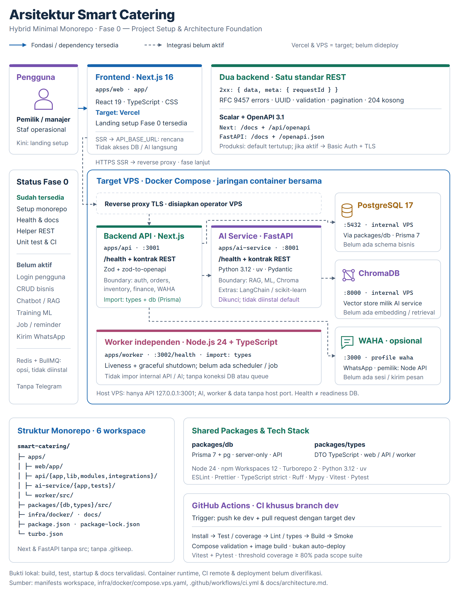

<p align="center">
  
</p>

<h1 align="center">Smart Catering</h1>

<p align="center">
  <em>Fondasi platform manajemen katering untuk Catering Si Kembar — Capstone Project Asah led by Dicoding dengan layanan operasional dan AI yang terpisah secara modular.</em>
</p>

<p align="center">
  <a href="#deskripsi-proyek"></a>
  <a href="#status-pengembangan"></a>
</p>

<p align="center">
  <a href="#arsitektur"></a>
  <a href="docs/environment.md"></a>
  <a href=".github/workflows/ci.yml"></a>
  <a href="#kontribusi"></a>
</p>

<p align="center">
  <a href="#deskripsi-proyek">Tentang</a> ·
  <a href="#fitur">Fitur</a> ·
  <a href="#arsitektur">Arsitektur</a> ·
  <a href="#usage">Usage</a> ·
  <a href="#pengujian-dan-ci">Pengujian &amp; CI</a> ·
  <a href="#kontribusi">Kontribusi</a> ·
  <a href="docs/README.md">Dokumentasi</a>
</p>

<p align="center">
  <a href="CHANGELOG.md">Changelog</a> ·
  <a href="https://github.com/Catering-Si-Kembar/smart-catering-/issues/new?title=%5BBug%5D%20">Report Bug</a> ·
  <a href="https://github.com/Catering-Si-Kembar/smart-catering-/issues/new?title=%5BFeature%5D%20">Request Feature</a>
</p>

> **Status: Fase 0 — Project Setup & Architecture Foundation.** Repository ini menyediakan fondasi pengembangan, bukan aplikasi katering dengan fitur bisnis yang sudah siap digunakan. Target deployment dan fitur fase berikutnya tidak berarti sudah aktif.

## Deskripsi proyek

**Smart Catering** adalah proyek capstone program **Asah led by Dicoding** yang dikembangkan untuk mendukung transformasi operasional mitra **Catering Si Kembar**.

Usaha katering dengan volume pesanan harian dan acara membutuhkan koordinasi yang presisi antara pencatatan pesanan pelanggan, penjadwalan dapur serta pengantaran, ketersediaan bahan baku, pencatatan pembayaran bertahap (uang muka/DP hingga pelunasan), serta komunikasi pengingat yang tepat waktu. Pengelolaan manual yang terpisah-pisah berisiko menimbulkan selisih stok dapur, keterlambatan tindak lanjut pesanan, dan rekapitulasi kas yang lambat.

**Visi produk Smart Catering** adalah membangun platform manajemen katering terpadu bagi **Catering Si Kembar** yang mencakup lima pilar kapabilitas pada fase pengembangan berikutnya (sesuai kebutuhan dan persetujuan mitra):

1. **Manajemen Pesanan & Penjadwalan (`orders`):** pencatatan siklus pesanan pelanggan, konfigurasi paket menu katering, jadwal acara/pengantaran, dan pemantauan status produksi.
2. **Manajemen Persediaan Bahan Baku (`inventory`):** pemantauan stok bahan baku dapur, satuan inventaris, mutasi keluar-masuk bahan, dan peringatan dini ketersediaan stok.
3. **Manajemen Keuangan (`finance`):** pencatatan tagihan pesanan, status pembayaran uang muka (DP) maupun pelunasan, arus kas pesanan, dan ringkasan transaksi keuangan.
4. **Bantuan AI — RAG & Machine Learning (`ai-service`):** pencarian konteks menu, FAQ, dan pengetahuan internal berbasis Retrieval-Augmented Generation (LangChain + ChromaDB) serta proyeksi permintaan menu, estimasi porsi, dan prediksi kebutuhan bahan baku berbasis Machine Learning (scikit-learn).
5. **Reminder & Integrasi Pesan (`worker` + `waha`):** eksekusi pengingat pesanan, jadwal produksi, dan tindak lanjut pembayaran melalui background worker mandiri serta adapter WhatsApp HTTP API (WAHA).

Repository menggunakan **Hybrid Minimal Monorepo** agar frontend, backend operasional, layanan AI, dan proses background dapat dikembangkan bersama tanpa mencampurkan tanggung jawab maupun ruang lingkup rahasianya. Ekosistem Node.js dikelola dengan **npm Workspaces + Turborepo**, sedangkan layanan Python dikelola dengan **uv**.

### Status pengembangan

Fase saat ini (**Fase 0 — Project Setup & Architecture Foundation**) berfokus pada struktur monorepo enam workspace, arsitektur environment dua sumber (`.env` root dan `apps/web/.env`), kontrak wire REST, dokumentasi OpenAPI 3.1.0 + Scalar, konfigurasi infrastruktur container, dan pemeriksaan kualitas lintas bahasa. **Seluruh modul bisnis (`auth`, `orders`, `inventory`, `finance`), pipeline RAG/ML, jadwal reminder, dan pengiriman pesan WhatsApp di atas masih berupa batas arsitektur (skeleton struktural) dan belum diimplementasikan pada Fase 0.** Halaman web yang tersedia adalah **landing setup**, bukan dashboard operasional. Belum ada layanan publik/deployment yang diverifikasi melalui README ini; lihat [hasil validasi dan batas buktinya](docs/README.md#status-dan-batas-bukti).

## Fitur

### Tersedia pada Fase 0

| Area                   | Fondasi yang tersedia                                                                                      |
| ---------------------- | ---------------------------------------------------------------------------------------------------------- |
| Monorepo               | Enam workspace, satu lockfile npm root, task development/build melalui Turborepo                           |
| Frontend               | Next.js App Router dengan landing setup Smart Catering                                                     |
| Backend operasional    | Next.js Route Handlers, health endpoint, boundary modul bisnis dan WAHA                                    |
| Backend AI             | FastAPI dengan health endpoint serta boundary RAG, ML, dan Chroma                                          |
| Kontrak REST           | Success envelope, RFC 9457 errors, UUID request ID, validasi, pagination helpers, dan helper 204           |
| Dokumentasi API        | Scalar + OpenAPI 3.1 pada kedua backend, dengan gerbang akses produksi                                     |
| Worker                 | Proses Node.js independen dengan liveness dan graceful shutdown                                            |
| Data dan infrastruktur | Dua sumber `.env` (root + `apps/web`), Prisma server-only, PostgreSQL/Chroma, WAHA opt-in, Compose dev/VPS |
| Quality dan CI         | Vitest, Pytest, coverage, lint, typecheck, build, dan smoke; workflow khusus `dev`                         |

### Rencana pengembangan — belum diimplementasikan

- Autentikasi dan otorisasi pengguna bisnis.
- Pengelolaan pesanan, persediaan bahan baku, dan keuangan.
- Chatbot/RAG, embedding/retrieval, serta training atau inference model ML.
- Job terjadwal dan reminder; WAHA untuk prototipe hanya setelah mendapat persetujuan mitra.

**Redis + BullMQ hanya opsi masa depan**, tidak diinstal atau dijalankan. Telegram tidak digunakan. Boundary modul bukan bukti fitur sudah tersedia; cakupan resmi tercatat dalam [PRD Fase 0](docs/PRD_FASE_0.md).

## Arsitektur

Frontend ditargetkan ke **Vercel**. API, AI service, worker, dan infrastruktur internal ditargetkan ke **VPS**. Pembagian ini tidak menjalankan worker terus-menerus di Vercel.

| Workspace         | Tanggung jawab                                       | Target penggunaan          |
| ----------------- | ---------------------------------------------------- | -------------------------- |
| `apps/web`        | Frontend Next.js; future server-side API fetch       | Vercel                     |
| `apps/api`        | Backend operasional dan pemilik integrasi WAHA       | VPS, Next.js standalone    |
| `apps/ai-service` | Backend Python; pemilik boundary RAG, ML, dan Chroma | VPS, FastAPI/Uvicorn       |
| `apps/worker`     | Proses background independen; saat ini liveness saja | VPS, Node.js               |
| `packages/db`     | Prisma schema/config dan akses database lazy         | Shared package server-only |
| `packages/types`  | Kontrak TypeScript bersama                           | Web, API, dan worker       |

<details>
<summary><strong>Lihat diagram arsitektur lengkap</strong></summary>



[PNG resolusi tinggi](docs/assets/smart-catering-architecture.png) · [SVG yang dapat diedit](docs/assets/smart-catering-architecture.svg)

Garis putus-putus menunjukkan integrasi yang belum aktif. Diagram menjelaskan fondasi Fase 0 dan target deployment, bukan klaim semua layanan sudah terhubung atau dideploy.

</details>

**Boundary utama:**

- Browser/web hanya membaca `apps/web/.env` (`NEXT_PUBLIC_APP_NAME` dan `API_BASE_URL` server-only) dan tidak mengakses root `.env`, database, Chroma, atau AI service secara langsung.
- API memiliki modul `auth`, `orders`, `inventory`, `finance`, serta integrasi `waha`. `AI_SERVICE_URL` disiapkan untuk komunikasi internal, tetapi belum dipanggil pada Fase 0.
- AI service memiliki boundary `rag`, `ml`, dan `chroma`. Extras LangChain/Chroma SDK dan scikit-learn dikunci dalam `uv.lock`, tetapi **tidak diinstal secara default**.
- Worker tidak mengimpor internal API/AI dan belum memiliki job, koneksi database, maupun queue.
- Di VPS, hanya API dipetakan ke host `127.0.0.1:3001` di belakang reverse proxy TLS. AI, worker, PostgreSQL, Chroma, dan WAHA tetap di jaringan container tanpa host port.

### Struktur repository

```text
./
├── apps/
│   ├── web/
│   │   ├── app/                         # Next.js frontend
│   │   └── .env.example                 # Template env khusus frontend
│   ├── api/
│   │   ├── app/                         # Route handlers, health, docs
│   │   ├── lib/                         # Kontrak REST dan OpenAPI
│   │   ├── modules/                     # Boundary bisnis
│   │   └── integrations/waha/           # Boundary WhatsApp
│   ├── ai-service/
│   │   ├── app/                         # FastAPI dan boundary AI
│   │   ├── tests/
│   │   ├── pyproject.toml
│   │   └── uv.lock
│   └── worker/src/                      # Node.js independen
├── packages/
│   ├── db/                              # Prisma, konfigurasi, src/
│   └── types/src/                       # Shared TypeScript types
├── scripts/                             # Launcher layanan, isolasi env, dan smoke test
├── infra/docker/                        # Compose dan Dockerfiles
├── docs/                                # PRD, ADR, panduan, aset
├── .github/workflows/ci.yml
├── .env.example                         # Template env root (backend, Prisma, Compose)
├── package.json
├── package-lock.json
└── turbo.json
```

Next.js dan FastAPI menggunakan layout tanpa `src` tambahan; worker dan shared packages tetap memakai `src`. Lihat [peta repository](docs/repository-structure.md) dan [keputusan arsitektur](docs/decisions/README.md) untuk detail.

## Teknologi

| Lapisan                   | Teknologi                                                         |
| ------------------------- | ----------------------------------------------------------------- |
| Workspace dan task runner | npm **12.1.0**, npm Workspaces, Turborepo **2.11.10**             |
| Runtime dan bahasa Node   | Node.js **24.15.0**, TypeScript **5.9.3**                         |
| Frontend dan API          | Next.js **16.4.5**, React **19.3.1**, CSS biasa                   |
| Runtime dan backend AI    | Python **3.12**, uv **0.13.7**, FastAPI, Pydantic, Uvicorn        |
| Data                      | PostgreSQL **17**, Prisma **7.10.1** + adapter `pg`, ChromaDB     |
| Kontrak API               | Zod + zod-to-openapi, Pydantic, OpenAPI **3.1**, Scalar           |
| Quality                   | ESLint, Prettier, Vitest/V8, Ruff, Mypy, Pytest/pytest-cov        |
| Deployment dan integrasi  | Vercel untuk web; Docker Compose/VPS untuk backend; WAHA opsional |

Dependency Node dikunci pada `package-lock.json` root, dependency Python pada `apps/ai-service/uv.lock`. Jangan menggunakan pnpm/Yarn atau membuat lockfile npm per workspace. Detail versi Python/extras tersedia di [pyproject.toml](apps/ai-service/pyproject.toml).

## Usage

### Prasyarat

- Git dan checkout repository; jalankan semua command berikut dari **root repository**.
- **Node.js 24.15.0** dan **npm 12.1.0**, sesuai `.nvmrc` dan `packageManager`.
- **Python 3.12** dan **uv 0.13.7**; proyek mendukung Python `>=3.12,<3.14`.
- **Docker Engine/Desktop + Docker Compose v2** hanya jika menjalankan infrastruktur/container.

Landing, health, dokumentasi API, generation Prisma, test, dan build dapat dijalankan **tanpa PostgreSQL/Chroma/WAHA online**. UI Scalar memerlukan koneksi browser ke bundle jsDelivr yang dipin; endpoint skema mentah tidak membutuhkan CDN.

### Quick start

**1. Install dependency Node dan Python.**

```sh
npm ci
npm run ai:sync
```

`ai:sync` menggunakan `uv sync --project apps/ai-service --frozen` tanpa extras RAG/ML. npm 12 membatasi lifecycle scripts melalui `allowScripts` root; jangan memberikan persetujuan blanket atau menghapus lockfile untuk menyamarkan error dependency.

**2. Siapkan dua file environment tanpa menimpa file yang sudah diisi.**

<details open>
<summary>Windows PowerShell</summary>

```powershell
@(
  '.env'
  'apps/web/.env'
) | ForEach-Object {
  if (-not (Test-Path -LiteralPath $_)) {
    Copy-Item -LiteralPath "$_.example" -Destination $_
  }
}
```

</details>

<details>
<summary>macOS / Linux</summary>

```sh
for file in .env apps/web/.env; do
  if [ ! -e "$file" ]; then
    cp "$file.example" "$file"
  fi
done
```

</details>

Repository ini hanya memakai **dua sumber environment** (`.env` di root dan `apps/web/.env`); tidak ada file `.env` atau `.env.example` tambahan di dalam `apps/api`, `apps/ai-service`, `apps/worker`, maupun `packages/db`:

- **Root `.env` (`.env.example` → `.env`):** sumber terpusat untuk konfigurasi native backend (`API_HOST`/`API_PORT`, `AI_HOST`/`AI_PORT`, `WORKER_HOST`/`WORKER_PORT`, `DATABASE_URL`, `AI_SERVICE_URL`, `CHROMA_URL`, `WAHA_BASE_URL`/`WAHA_API_KEY`, `DOCS_ENABLED`/`DOCS_USERNAME`/`DOCS_PASSWORD`), Prisma CLI (`db:generate` / `db:validate`), serta interpolasi Docker Compose. Launcher layanan hanya meneruskan variabel sesuai allowlist masing-masing service (dan tidak pernah memuat root `.env` ke `apps/web`).
- **Frontend `apps/web/.env` (`apps/web/.env.example` → `apps/web/.env`):** dimuat oleh Next.js frontend dan hanya berisi `NEXT_PUBLIC_APP_NAME` serta `API_BASE_URL` (server-only).

Variabel konfigurasi service yang diinjeksikan langsung pada proses/shell menang di atas nilai file `.env`; mode `NODE_ENV`/`APP_ENV` tetap dikendalikan command launcher. Pada `.env.example` root, nilai kredensial, URL database, dan `DOCS_ENABLED` sengaja dikosongkan; lihat [panduan environment](docs/environment.md). Jangan commit `.env` nyata.

**3. Generate Prisma Client dan jalankan aplikasi.**

```sh
npm run db:generate
npm run dev:all
```

Pilihan command development dari root repository:

- **Semua aplikasi (4 layanan — `web` + `api` + `ai-service` + `worker`):** `npm run dev:all`
- **Default (2 layanan — `web` + `api`):** `npm run dev`
- **Hanya frontend (`web`):** `npm run dev:web`
- **Semua layanan backend (`api` + `ai-service` + `worker`):** `npm run dev:backend`
- **Layanan individual:** `npm run dev:api`, `npm run dev:ai`, atau `npm run dev:worker`

Setiap command `dev*` menetapkan mode `development` secara otomatis (`NODE_ENV=development` untuk Node dan `APP_ENV=development` untuk AI service). Hentikan proses foreground dengan **Ctrl+C**.

### Akses lokal dan dokumentasi OpenAPI/Scalar

| Komponen                     | Alamat default                                                      |
| ---------------------------- | ------------------------------------------------------------------- |
| Web                          | <http://localhost:3000>                                             |
| API health                   | <http://localhost:3001/health>                                      |
| API Scalar / OpenAPI         | <http://localhost:3001/docs> · <http://localhost:3001/api/openapi>  |
| AI health                    | <http://127.0.0.1:8001/health>                                      |
| AI Scalar / OpenAPI          | <http://127.0.0.1:8001/docs> · <http://127.0.0.1:8001/openapi.json> |
| Worker liveness              | <http://127.0.0.1:3002/health>                                      |
| PostgreSQL, jika infra aktif | `127.0.0.1:5432`                                                    |
| Chroma, jika infra aktif     | <http://127.0.0.1:8000>                                             |
| WAHA, jika profil aktif      | <http://127.0.0.1:3003>                                             |

Endpoint health hanya membuktikan **liveness proses**, bukan readiness database, vector store, atau WhatsApp. Port di tabel ini adalah port development host; port dan eksposur VPS berbeda.

### Menjalankan infrastruktur opsional

Pastikan Docker Engine berjalan. Isi root `.env` dengan `POSTGRES_PASSWORD` dan `WAHA_API_KEY` acak, kuat, dan berbeda **sebelum command Compose apa pun**. Key WAHA tetap diperlukan untuk interpolasi walaupun profilnya belum diaktifkan.

```sh
npm run infra:config
npm run infra:up
```

Defaultnya menjalankan PostgreSQL dan Chroma. WAHA tidak otomatis dinyalakan:

```sh
npm run infra:waha
```

Mengaktifkan container WAHA **tidak** membuat sesi WhatsApp atau mengirim pesan. Prototipe integrasi membutuhkan persetujuan mitra. Hentikan infrastruktur tanpa menghapus named volumes dengan:

```sh
npm run infra:down
```

### Build dan menjalankan hasil build

```sh
npm run db:validate
npm run build
npm run start
```

`start` secara default menjalankan built **web + API**. Gunakan command berikut untuk menjalankan seluruh aplikasi, khusus backend, atau layanan individual setelah `npm run build`:

```sh
npm run start:all
npm run start:backend
npm run start:web
npm run start:api
npm run start:ai
npm run start:worker
```

Launcher `start*` menjalankan proses dalam mode produksi (`NODE_ENV=production` untuk Node, `APP_ENV=production` untuk AI service). Built API dijalankan sebagai **standalone server** dengan memetakan `API_HOST` dan `API_PORT` (default `127.0.0.1:3001`) ke `HOSTNAME`/`PORT` internal tanpa memercayai `HOSTNAME`/`PORT` warisan shell; `start:ai` menjalankan Uvicorn tanpa reload pada `AI_HOST`:`AI_PORT` (default `127.0.0.1:8001`); `start:worker` menjalankan worker pada `WORKER_HOST`:`WORKER_PORT` (default `127.0.0.1:3002`). Di container VPS, layanan hanya menerima variabel `environment` yang dideklarasikan secara eksplisit pada file Compose. Panduan ini bukan instruksi provisioning server; lihat [deployment VPS](docs/deployment-vps.md) untuk host, rahasia, TLS, dan container.

## Standar kontrak REST, OpenAPI 3.1, dan keamanan

Kedua backend menggunakan kontrak yang sama. Contoh envelope sukses:

```json
{
  "data": { "status": "ok", "service": "api" },
  "meta": { "requestId": "<uuid>" }
}
```

- **200/201:** envelope `data` dan `meta`; respons berpaginasi dapat menambahkan `meta.pagination`.
- **204:** body kosong, tanpa `Content-Type` JSON, tetap menyertakan `X-Request-Id`.
- **400/401/403/404/405/422/500:** RFC 9457 dengan `application/problem+json`. JSON rusak menghasilkan 400; validasi skema menghasilkan 422. Error 500 tidak mengekspos pesan exception internal, input, SQL, atau stack trace.
- **Request ID:** UUID kanonis v1–v8 dinormalisasi; nilai hilang/tidak valid diganti UUIDv4. ID tersedia pada header `X-Request-Id` dan body JSON.
- **Pagination:** helper dan skema reusable tersedia; belum ada endpoint list bisnis pada Fase 0.
- **Pengecualian envelope:** skema OpenAPI tetap JSON mentah, `/docs` berupa HTML, dan worker mengembalikan liveness internal `{"status":"ok","service":"worker"}`.

### Akses dokumentasi di produksi

Dokumentasi default aktif pada development/test, **nonaktif pada produksi** (`NODE_ENV=production` untuk API, `APP_ENV=production` untuk AI). Saat nonaktif, `/docs` **dan** endpoint skema mengembalikan 404.

Jika diaktifkan melalui `DOCS_ENABLED=true`, produksi mewajibkan `DOCS_USERNAME` dan `DOCS_PASSWORD` minimal 32 karakter melalui **HTTP Basic di belakang TLS**. Kredensial salah menghasilkan 401; konfigurasi tidak aman gagal tertutup dengan 500 generik. Respons dokumentasi menggunakan `private, no-store` dan `Vary: Authorization`.

Scalar memakai bundle yang dipin; AI agent, telemetry, persistensi auth, remote proxy, dan font eksternal dinonaktifkan. Kredensial tidak disisipkan ke HTML, URL, atau request CDN.

Kontrak helper berlaku pada request yang mencapai handler. Penolakan transport sebelum handler—misalnya `TRACE` pada Next.js—harus ditangani oleh kebijakan reverse proxy. Detail validasi, pagination, dan batas framework ada di [kontrak arsitektur](docs/architecture.md#kontrak-wire-rest-openapi-310-dan-keamanan-dokumentasi).

## Perintah utama

<details>
<summary><strong>Daftar script npm dari root repository</strong></summary>

| Command                                                                                 | Kegunaan                                                      |
| --------------------------------------------------------------------------------------- | ------------------------------------------------------------- |
| `npm run ai:sync`                                                                       | Sinkronisasi environment Python dari uv.lock                  |
| `npm run build:packages`                                                                | Build shared db/types                                         |
| `npm run dev` / `npm run dev:all`                                                       | Development `web` + `api` (default) / keempat aplikasi        |
| `npm run dev:web` / `npm run dev:backend`                                               | Development frontend saja / ketiga layanan backend            |
| `npm run dev:api` / `npm run dev:ai` / `npm run dev:worker`                             | Development layanan backend individual                        |
| `npm run infra:config` / `npm run infra:up` / `npm run infra:down`                      | Validasi / start / stop infra                                 |
| `npm run infra:waha`                                                                    | Aktifkan profil WAHA opsional                                 |
| `npm run db:generate` / `npm run db:validate`                                           | Prisma Client generation / schema validation                  |
| `npm run lint` / `npm run typecheck`                                                    | ESLint/Ruff dan TypeScript/Mypy                               |
| `npm test` / `npm run test:coverage`                                                    | Test Node + Python, dengan/tanpa laporan coverage             |
| `npm run format` / `npm run format:check`                                               | Format / periksa format Prettier + Ruff                       |
| `npm run build`                                                                         | Build enam workspace termasuk distribusi Python               |
| `npm run start` / `npm run start:all`                                                   | Menjalankan built `web` + `api` (default) / keempat aplikasi  |
| `npm run start:backend`                                                                 | Menjalankan ketiga layanan backend hasil build                |
| `npm run start:web` / `npm run start:api` / `npm run start:ai` / `npm run start:worker` | Menjalankan masing-masing aplikasi hasil build secara mandiri |
| `npm run smoke`                                                                         | Periksa startup, kontrak HTTP/docs, dan shutdown empat proses |

</details>

Gunakan `npm install` untuk perubahan dependency Node dan `uv lock` dari `apps/ai-service` untuk perubahan dependency Python. File generated/cache seperti `.next/`, `.turbo/`, `coverage/`, dan `.venv/` diabaikan Git; dokumentasi proyek tetap dilacak.

## Pengujian dan CI

Jalankan pemeriksaan berikut setelah dependency dan environment disiapkan:

```sh
npm run format:check
npm run lint
npm run db:generate
npm run db:validate
npm run typecheck
npm run test:coverage
npm run build
npm run smoke
```

Bebaskan port `3000`, `3001`, `3002`, dan `8001` sebelum `smoke`. Vitest V8 memeriksa helper API, environment worker, dan loader environment layanan (`scripts/service-environment.mjs`); Pytest memeriksa `apps/ai-service/app`. Threshold minimum coverage **80% berlaku pada scope suite**, bukan klaim seluruh UI/repository sudah tercakup.

Workflow [CI Dev](.github/workflows/ci.yml) hanya terpicu pada **push ke `dev`** dan **pull request bertarget `dev`**. Workflow mencakup test/coverage, quality checks, Prisma, build, smoke, validasi Compose, serta build image VPS tanpa deployment. Coverage diunggah sebagai artifact CI.

Hasil lokal tercatat pada [bukti validasi](docs/README.md#status-dan-batas-bukti). Build/start container dan koneksi infrastruktur memerlukan Docker Engine; konfigurasi workflow bukan bukti run GitHub, branch protection, atau deployment sudah berhasil. Tidak ada badge CI/deployment yang menyatakan keberhasilan belum terverifikasi.

## Deployment

| Target | Cakupan                                                        | Panduan                                        |
| ------ | -------------------------------------------------------------- | ---------------------------------------------- |
| Vercel | `apps/web` saja                                                | [Deployment Vercel](docs/deployment-vercel.md) |
| VPS    | API, AI service, worker, PostgreSQL, Chroma, dan WAHA opsional | [Deployment VPS](docs/deployment-vps.md)       |

Reverse proxy, TLS, DNS, backup, rahasia, dan akses server dikelola operator. Scheduler/reminder fase berikutnya dapat berada di VPS; tidak memerlukan worker terus-menerus di Vercel atau ketergantungan pada Vercel Cron Hobby.

## Struktur dan dokumentasi

| Dokumen                                                                            | Isi                                                |
| ---------------------------------------------------------------------------------- | -------------------------------------------------- |
| [Indeks dokumentasi](docs/README.md)                                               | Navigasi dan bukti validasi                        |
| [PRD Fase 0](docs/PRD_FASE_0.md)                                                   | Scope dan acceptance criteria                      |
| [Struktur repository](docs/repository-structure.md)                                | Pemilik source, entry point, dan artefak generated |
| [Arsitektur](docs/architecture.md)                                                 | Diagram, boundary, kontrak API, dan topologi       |
| [Development](docs/development.md)                                                 | Setup lengkap, script, dan troubleshooting         |
| [Environment](docs/environment.md)                                                 | File env, variabel, dan keamanan                   |
| [Architecture Decision Records](docs/decisions/README.md)                          | Alasan keputusan arsitektur                        |
| [Rencana implementasi](docs/superpowers/plans/2026-11-04-fase-0-setup-monorepo.md) | Rencana Fase 0 yang diterima                       |
| [Changelog](CHANGELOG.md)                                                          | Riwayat perubahan                                  |

## Kontribusi

### Tim dan kontributor

**Smart Catering** dikembangkan oleh tim Capstone **Asah led by Dicoding** bekerja sama dengan mitra **Catering Si Kembar**.

[Kontributor GitHub](https://github.com/Catering-Si-Kembar/smart-catering-/graphs/contributors) · [Pull requests](https://github.com/Catering-Si-Kembar/smart-catering-/pulls) · [Repository resmi](https://github.com/Catering-Si-Kembar/smart-catering-)

| Area kepemilikan                       | Cakupan workspace & artefak                                          |
| -------------------------------------- | -------------------------------------------------------------------- |
| Frontend Web                           | `@smart-catering/web` (`apps/web`)                                   |
| Backend Operasional & Kontrak Database | `@smart-catering/api` (`apps/api`), `@smart-catering/db`             |
| Layanan AI (RAG, ML & Chroma Boundary) | `@smart-catering/ai-service` (`apps/ai-service`)                     |
| Background Worker & Infrastruktur      | `@smart-catering/worker` (`apps/worker`), `infra/docker`, `scripts/` |
| Kontrak Tipe, Pengujian & Dokumentasi  | `@smart-catering/types` (`packages/types`), `docs/`, CI workflow     |

> Repository ini bersifat **private**. Daftar kontributor dan statistik dapat dilihat melalui halaman GitHub oleh pengguna yang memiliki akses; README tidak memakai generator avatar/statistik pihak ketiga yang tidak dapat membaca repository private.

### Pelaporan bug dan permintaan fitur

- **Report Bug (Laporan Bug):** Sertakan command yang dijalankan (misalnya `npm run dev:backend` atau `npm run smoke`), sistem operasi, output `node --version`, `npm --version`, dan `uv --version`, serta pesan error lengkap. **Jangan pernah** menyertakan isi file `.env`, password database, `WAHA_API_KEY`, atau `DOCS_PASSWORD` di dalam laporan.
- **Request Feature (Permintaan Fitur):** Jelaskan masalah operasional di **Catering Si Kembar** yang ingin diselesaikan, workspace yang terdampak (`web`, `api`, `ai-service`, `worker`, `db`, atau `types`), serta kesesuaiannya dengan boundary arsitektur di [PRD Fase 0](docs/PRD_FASE_0.md) dan [ADR](docs/decisions/README.md).

### Alur kontribusi teknis

1. Tempatkan perubahan pada workspace pemiliknya; jangan mengimpor DB/secret ke `apps/web` atau internal API/AI ke `apps/worker`.
2. Pertahankan `package-lock.json` root dan `apps/ai-service/uv.lock`, serta gunakan hanya dua sumber environment lokal (`.env` dan `apps/web/.env`) tanpa meng-commit secret, cache, atau laporan coverage.
3. Jalankan [pemeriksaan sebelum PR](docs/development.md#pemeriksaan-sebelum-pr), lalu ajukan PR ke branch `dev` sesuai kebijakan tim.
4. Perbarui dokumentasi dan ADR bila kontrak wire, skrip, variabel environment, atau keputusan arsitektur berubah.

## Identitas mitra

Nama platform adalah **Smart Catering**, dengan **Catering Si Kembar** sebagai mitra proyek. Logo resmi pada header berasal dari aset yang diberikan mitra dan disimpan tanpa mengubah desainnya di [`docs/assets/logo-katering-si-kembar.png`](docs/assets/logo-katering-si-kembar.png). Penyertaan logo bukan penetapan lisensi kode atau izin penggunaan ulang merek di luar proyek.
