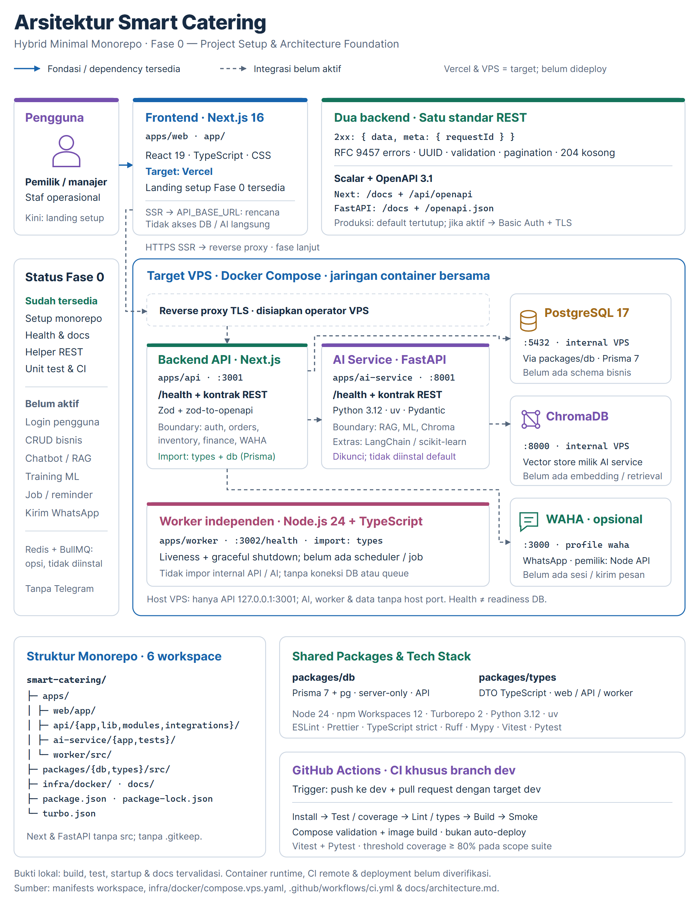

# Arsitektur — Hybrid Minimal Monorepo

**Diperbarui:** 2026-11-05 · **Keputusan:** diterima untuk Fase 0 (6-Workspace REST/OpenAPI & Python AI Foundation)

## Diagram arsitektur



[PNG resolusi tinggi](assets/smart-catering-architecture.png) · [SVG vektor yang dapat diedit](assets/smart-catering-architecture.svg)

Garis putus-putus menunjukkan integrasi yang **belum aktif**, bukan alur bisnis yang sudah berjalan. Vercel dan VPS adalah target deployment; diagram tidak mengklaim deployment cloud atau runtime container sudah diverifikasi. Port pada panel VPS adalah port internal container; hanya API dipetakan ke loopback host. Worker tetap independen dari internal API/AI.

## Topologi deployment

```text
Browser
  │ HTTPS
  ▼
apps/web — Vercel (satu project)
  │ future server-side HTTPS fetch melalui API_BASE_URL
  │ (belum ada fetch bisnis pada Fase 0)
  ▼
Reverse proxy TLS — VPS (dikelola operator)
  │ loopback host 127.0.0.1:3001
  ▼
apps/api — Next.js standalone (:3001) ──────► PostgreSQL (internal :5432)
  │  (/health, /docs, /api/openapi)           WAHA (internal :3000, profile opsional)
  │
  │ future internal HTTP melalui AI_SERVICE_URL (http://ai-service:8001)
  │ (belum ada pemanggilan antar-layanan pada Fase 0)
  ▼
apps/ai-service — Python FastAPI/Uvicorn (:8001, internal VPS saja)
     (/health, /docs, /openapi.json)  ──────► Chroma (internal :8000)

apps/worker — proses Node.js always-on independen pada VPS
  └─ liveness internal :3002 di jaringan container; belum ada job/koneksi eksternal
```

API, AI service, worker, PostgreSQL, dan Chroma ditargetkan ke VPS. WAHA disediakan sebagai layanan opt-in internal untuk fase integrasi berikutnya; konfigurasi container bukan integrasi WhatsApp aktif. Redis + BullMQ boleh dipertimbangkan kelak bila ada kebutuhan queue yang nyata; **tidak ada dependency, container, atau konsumennya pada Fase 0**. Tidak ada integrasi Telegram.

Hanya API (`127.0.0.1:3001`) yang dipetakan ke loopback host VPS untuk diteruskan oleh reverse proxy TLS eksternal. `ai-service` (`:8001`), `worker` (`:3002`), PostgreSQL (`:5432`), Chroma (`:8000`), dan WAHA (`:3000`) **tidak dipublikasikan ke host VPS** dan hanya berkomunikasi di dalam jaringan bridge Docker internal (`smart_catering_vps_net`). Browser maupun Vercel tidak mengakses layanan AI, database, vector store, atau WAHA secara langsung.

## Enam workspace dan arah dependency

```text
@smart-catering/web        ──► @smart-catering/types
@smart-catering/api        ──► @smart-catering/types
                           └─► @smart-catering/db ──► Prisma + pg
@smart-catering/worker     ──► @smart-catering/types
@smart-catering/ai-service ──► Python 3.12 / uv (FastAPI, Pydantic, Uvicorn, scalar-fastapi)
                               (terintegrasi ke Turbo melalui wrapper package.json tanpa Node deps)
```

- **Kepemilikan Domain & AI yang Terpisah**:
  - `@smart-catering/api` memiliki modul bisnis transaksional (`apps/api/modules/{auth,orders,inventory,finance}`) dan integrasi WhatsApp (`apps/api/integrations/waha`). API menyimpan variabel konfigurasi `AI_SERVICE_URL` untuk mendelegasikan operasi AI ke `@smart-catering/ai-service` pada fase mendatang, namun tidak memanggilnya dan tidak membutuhkan `ai-service` hidup saat startup/health Fase 0.
  - `@smart-catering/ai-service` memiliki seluruh boundary RAG (`app/rag`), ML (`app/ml`), dan Chroma (`app/chroma`), serta variabel `CHROMA_URL`. Direktori placeholder lama `rag`, `ml`, dan `chroma` di dalam `apps/api` telah dihapus agar tidak ada arsitektur ganda.
  - Optional extras Python (`rag`: `langchain==1.4.8`, `chromadb==1.5.9`; `ml`: `scikit-learn==1.9.1`) dideklarasikan di `apps/ai-service/pyproject.toml` dan dikunci di `apps/ai-service/uv.lock`, tetapi tidak di-install pada `npm run ai:sync` default maupun image Docker produksi (`uv sync --frozen --no-dev`) sampai fitur RAG/ML diimplementasikan.
- **Independensi Worker**:
  - `@smart-catering/worker` dapat bergantung pada `db` ketika ada pekerjaan yang benar-benar membutuhkan DB kelak, tetapi **tidak boleh mengimpor `apps/api` maupun `apps/ai-service`**. Ia harus build/start/restart secara mandiri dan pada Fase 0 hanya menjalankan HTTP liveness internal (`:3002/health`) serta graceful shutdown handler.
- **Konvensi Paket & Build**:
  - Satu `package-lock.json` di root mengelola seluruh dependency Node.js; `apps/ai-service/uv.lock` mengelola seluruh dependency Python.
  - Packages `types` dan `db` dikompilasi ke `dist` sebagai ES modules dengan deklarasi TypeScript. Dependency internal Node adalah exact `0.0.0`.
  - Kedua aplikasi Next (`apps/web/app`, `apps/api/app`) dan aplikasi FastAPI (`apps/ai-service/app`) tidak memakai lapisan `src`. Hanya `apps/worker/src`, `packages/db/src`, dan `packages/types/src` yang memakai `src`.

## Kontrak wire REST, OpenAPI 3.1.0, dan keamanan dokumentasi

Kedua backend REST (`@smart-catering/api` dan `@smart-catering/ai-service`) mematuhi kontrak protokol yang sama:

### 1. Envelope respons sukses dan pengecualian protokol

- **`200 OK` / `201 Created`**:
  ```json
  {
    "data": { "status": "ok", "service": "api" },
    "meta": { "requestId": "0192f0c8-7b3a-7000-8000-000000000001" }
  }
  ```
  Pada `@smart-catering/ai-service`, `data.service` bernilai `"ai-service"`. Respons berpaginasi pada fase mendatang menambahkan `meta.pagination: { page, limit, total, totalPages }`.
- **`204 No Content`**: helper mengembalikan body kosong tanpa header `Content-Type` JSON, dengan tetap menyertakan header `X-Request-Id`.
- **Metode `HEAD`**: pada `/health`, `/docs`, dan endpoint skema OpenAPI mengikuti status HTTP, pemeriksaan autentikasi, dan header `GET` dengan body kosong.
- **Pengecualian eksplisit dari envelope `{ data, meta }`**:
  1. **Endpoint skema OpenAPI (`/api/openapi` pada API dan `/openapi.json` pada AI service)**: mengembalikan dokumen JSON OpenAPI `3.1.0` mentah agar dapat dikonsumsi langsung oleh Scalar dan validator OpenAPI.
  2. **Endpoint UI dokumentasi (`/docs`)**: mengembalikan dokumen HTML Scalar API Reference.
  3. **Endpoint liveness internal worker (`GET http://127.0.0.1:3002/health`)**: worker bukan backend REST bisnis dan tetap mengembalikan objek `HealthData` mentah `{"status":"ok","service":"worker"}`.

### 2. Penanganan error RFC 9457 (`application/problem+json`)

Semua respons error (`400`, `401`, `403`, `404`, `405`, `422`, `500`) pada API dan AI service menggunakan `Content-Type: application/problem+json`:

```json
{
  "type": "about:blank",
  "title": "Unprocessable Content",
  "status": 422,
  "detail": "Request validation failed.",
  "instance": "/health",
  "requestId": "0192f0c8-7b3a-7000-8000-000000000001",
  "errors": [
    {
      "path": "page",
      "code": "invalid_value",
      "message": "Invalid value"
    }
  ]
}
```

- `instance` hanya memuat pathname URL tanpa query string.
- JSON body yang rusak (malformed) menghasilkan `400 Bad Request`; struktur JSON valid dengan nilai/tipe field tidak sah menghasilkan `422 Unprocessable Content` beserta array `errors` (prefix lokasi FastAPI `body`/`query`/`path`/`header` dihapus sehingga path field selaras antara Node dan Python).
- Error tak terduga (`500 Internal Server Error`) selalu mengembalikan `"detail": "An unexpected error occurred."` tanpa membocorkan exception message, stack trace, input pengguna, SQL, atau variabel environment.

### 3. Korelasi `X-Request-Id` dan kontrak paginasi

- **RequestId**: setiap request membaca header `X-Request-Id`. Bila nilainya berupa UUID RFC kanonis (versi 1–8), nilai tersebut dipertahankan dalam huruf kecil (lowercase). Bila kosong, terlalu panjang, atau bukan UUID kanonis, backend membangkitkan UUIDv4 baru tanpa menolak request. Nilai yang sama selalu dikirim pada header `X-Request-Id` dan body JSON.
- **Paginasi reusable**: `page` (default `1`), `limit` (default `20`, maksimum `100`), `total` (integer aman non-negatif `<= 9007199254740991`), `totalPages = ceil(total / limit)` (`0` jika `total === 0`). Helper menolak boolean, pecahan, angka negatif/nol, string non-desimal (seperti heksadesimal/notasi ilmiah), integer di luar `Number.MAX_SAFE_INTEGER`, serta overflow perhitungan offset.

### 4. Gerbang keamanan OpenAPI 3.1.0 & Scalar (`/docs`)

- Spesifikasi OpenAPI **3.1.0** dihasilkan dari skema kode (Zod + `@asteasolutions/zod-to-openapi` di Node API; Pydantic + FastAPI di Python AI service).
- UI Scalar memakai bundle klasik yang dipin ke **`https://cdn.jsdelivr.net/npm/@scalar/api-reference@1.76.4`** dengan AI agent, telemetry, persistensi auth, remote proxy, dan font default dinonaktifkan. Browser memerlukan akses internet ke `cdn.jsdelivr.net` saat merender `/docs`.
- Kebijakan `DOCS_ENABLED`:
  - Default `true` saat development/test (`NODE_ENV` != `production` / `APP_ENV` != `production`).
  - Default **`false`** saat produksi (`NODE_ENV=production` / `APP_ENV=production`); hanya menerima string `"true"` atau `"false"` (nilai lain gagal tertutup).
  - Saat nonaktif, request ke `/docs` maupun endpoint skema (`/api/openapi` atau `/openapi.json`) mengembalikan `404` Problem Details.
  - Saat diaktifkan di produksi (`DOCS_ENABLED=true`), backend mewajibkan `DOCS_USERNAME` terisi dan `DOCS_PASSWORD` minimal **32 karakter**. Bila kredensial env belum dikonfigurasi dengan benar, backend mengembalikan `500` Problem Details generik (fail-closed). Bila header `Authorization: Basic ...` tidak ada atau salah, backend mengembalikan `401` Problem Details beserta `WWW-Authenticate: Basic realm="Smart Catering Docs", charset="UTF-8"`.
  - Seluruh respons `/docs` dan skema OpenAPI menyertakan `Cache-Control: private, no-store` dan `Vary: Authorization`.

## Boundary server dan browser

- `packages/types` hanya kontrak type TypeScript; tidak memuat DB, secret, atau client provider.
- `packages/db` server-only. Browser condition pada export bernilai `null`; lint melarang dependency DB/API/worker dari web.
- **Isolasi dua sumber `.env`:** `apps/web` hanya membaca `apps/web/.env` (`NEXT_PUBLIC_APP_NAME` dan `API_BASE_URL` server-only) dan tidak pernah membaca root `.env`. Sebaliknya, root `.env` dipakai untuk backend (`api`, `ai-service`, `worker`), Prisma CLI, dan Docker Compose dengan penyaringan allowlist per layanan melalui `scripts/service-environment.mjs`, `scripts/run-service.mjs`, serta `apps/ai-service/app/config.py` (tanpa workspace `.env` tambahan di `apps/api`, `apps/ai-service`, `apps/worker`, atau `packages/db`).
- `API_BASE_URL` adalah env **server-only** web untuk future SSR/server action. Jangan menggantinya dengan env `NEXT_PUBLIC_*` atau meneruskan secret ke props/HTML/client bundle.
- `AI_SERVICE_URL` adalah env **server-only** pada `apps/api` untuk komunikasi backend-ke-AI internal di masa depan; browser dan Vercel tidak memanggil `ai-service` secara langsung.

## Lokal dibanding VPS

| Layanan       | Pengembangan & start native host                                     | VPS (Docker Compose)                                               |
| ------------- | -------------------------------------------------------------------- | ------------------------------------------------------------------ |
| Web           | `http://localhost:3000` (`apps/web/.env`)                            | Vercel, bukan Compose VPS                                          |
| API           | `http://localhost:3001` (`API_HOST`:`API_PORT` dari root `.env`)     | Container `:3001` → host `127.0.0.1:${API_PORT:-3001}` → TLS proxy |
| AI Service    | `http://127.0.0.1:8001` (`AI_HOST`:`AI_PORT` dari root `.env`)       | `0.0.0.0:8001` tetap di jaringan container internal saja           |
| Worker        | `http://127.0.0.1:3002` (`WORKER_HOST`:`WORKER_PORT` di root `.env`) | `0.0.0.0:3002` tetap di jaringan container internal saja           |
| PostgreSQL    | `127.0.0.1:5432` (`POSTGRES_PORT`)                                   | Jaringan container internal saja (`postgres:5432`)                 |
| Chroma        | `http://127.0.0.1:8000` (`CHROMA_PORT`)                              | Jaringan container internal saja (`chroma:8000`)                   |
| WAHA opsional | `http://127.0.0.1:3003` (`WAHA_PORT`)                                | Jaringan container internal saja (`waha:3000`, profile `waha`)     |

## Konsekuensi dan status bukti

Hybrid memisahkan lifecycle web serverless dari API, AI service, dan worker always-on di VPS, sekaligus memberikan ekosistem Python `uv` asli untuk beban kerja RAG/ML masa depan tanpa mengorbankan keseragaman kontrak REST/OpenAPI 3.1. Baca [ADR](decisions/README.md) dan [deployment VPS](deployment-vps.md). Status verifikasi mengikuti [batas bukti](README.md#status-dan-batas-bukti).
