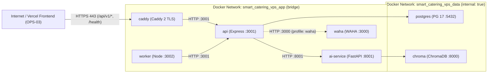

# Deployment VPS — Express API, AI Service, Worker, Caddy HTTPS & Infrastruktur Internal (`OPS-02`)

**Diperbarui:** 2026-11-27 · **Acuan:** Issue [#24](https://github.com/Catering-Si-Kembar/smart-catering/issues/24) · **Status:** konfigurasi produksi, preflight guard, & skrip verifikasi siap di kode/CI; provisioning VPS live menunggu konfirmasi server & domain tim

## Layanan dan prasyarat

VPS menjalankan **Express REST API (`/api/v1`, `:3001`)**, **AI service Python/FastAPI (`:8001`)**, **worker Node.js independen (`:3002`)**, **PostgreSQL 17 (`:5432`)**, dan **ChromaDB (`:8000`)** di balik **Caddy 2 Reverse Proxy HTTPS (`80`/`443`, profile opt-in `proxy`)**. **WAHA (`:3000`)** diaktifkan hanya melalui profile opt-in `waha`. Frontend Next.js tetap di-deploy terpisah di Vercel (`OPS-03`). Redis + BullMQ tidak digunakan pada MVP; tidak ada integrasi Telegram.

Spesifikasi VPS minimal yang disarankan: **2 vCPU, 4 GB RAM, 40 GB SSD (Ubuntu 24.04 LTS)** dengan Docker Engine + Compose v2 dan firewall UFW yang hanya membuka port `22/tcp` (SSH), `80/tcp` (ACME/redirect HTTP), `443/tcp`, dan `443/udp` (HTTPS/HTTP3).



## File dan build context

- [`infra/docker/compose.vps.yaml`](../infra/docker/compose.vps.yaml): orkestrasi `postgres`, `chroma`, `api`, `ai-service`, `worker`, serta profile opt-in `proxy` (`caddy`) dan `waha` (`waha`). Seluruh service memiliki `restart: unless-stopped`, `healthcheck`, `no-new-privileges:true`, rotasi log (`10m` x `3`), batas memori default aman untuk VPS 4 GB RAM, serta image pihak ketiga yang di-pin `@sha256:...`.
- [`infra/docker/Caddyfile`](../infra/docker/Caddyfile): reverse proxy HTTPS otomatis (Let's Encrypt) pada `{$API_DOMAIN}` dengan `admin off`, pembatasan metode HTTP (menolak `TRACE`/`CONNECT`/dsb. dengan `405`), allowlist rute publik (`/api/v1/*`, `/health`, serta `/docs*` yang tetap fail-closed di Express), header keamanan (`HSTS`, `X-Content-Type-Options`, `X-Frame-Options`, `Referrer-Policy`), batas body `2MB`, dan redaksi log untuk `Authorization`, `Cookie`, `X-Internal-Token`, serta parameter query sensitif.
- [`infra/docker/api.Dockerfile`](../infra/docker/api.Dockerfile): build multi-stage Node `24.15.0-alpine3.23` (digest ter-pin) untuk `@smart-catering/types`, `@smart-catering/db`, dan `@smart-catering/api`; runtime non-root (`USER node`).
- [`infra/docker/ai-service.Dockerfile`](../infra/docker/ai-service.Dockerfile): build `python:3.12.16-slim-bookworm` (digest ter-pin) dengan `uv==0.13.7` dan default `ARG AI_SERVICE_EXTRAS="--extra ml --extra rag --extra insight"` agar modul ML (`AI-02`/`AI-03`), RAG/Chroma (`AI-05`), dan Modal Insight (`AI-06`) siap di produksi; runtime non-root (`USER aiservice`, UID `10001`), `APP_ENV=production`, `DOCS_ENABLED=false`, `--no-access-log`.
- [`infra/docker/worker.Dockerfile`](../infra/docker/worker.Dockerfile): build multi-stage independen untuk `@smart-catering/types` dan `@smart-catering/worker`; runtime non-root (`USER node`).
- [`infra/docker/verify-vps.sh`](../infra/docker/verify-vps.sh): skrip verifikasi operasional di VPS (cek `healthy`, isolasi port publik, probe HTTPS TLS + tolak `TRACE` 405, serta uji persistensi restart PostgreSQL & ChromaDB).
- [`scripts/check-vps-compose.mjs`](../scripts/check-vps-compose.mjs): preflight guard otomatis (`npm run infra:vps:check`) yang dijalankan di lokal & CI untuk mengunci isolasi port/jaringan, pinning image, keamanan `Caddyfile`, dan extras `ai-service.Dockerfile`.

## Environment sebelum menjalankan Compose

Dari root checkout pada VPS:

```sh
cp .env.example .env
```

Jangan overwrite `.env` yang sudah ada dan **jangan pernah meng-commit `.env` ke Git**. Sebelum menjalankan Compose VPS, isi variabel wajib berikut dengan nilai acak kuat yang berbeda (mis. `node -e "console.log(require('node:crypto').randomBytes(32).toString('hex'))"`):

- `POSTGRES_PASSWORD` dan `VPS_DATABASE_URL` (host internal `postgres:5432` dengan kredensial ter-URL-encode).
- `INTERNAL_SERVICE_SECRET` (wajib sama untuk `api`, `ai-service`, dan `worker`).
- `API_DOMAIN` (mis. `api.<domain-anda>`) dan `TLS_EMAIL` (wajib saat mengaktifkan `--profile proxy`).
- `WAHA_API_KEY` (wajib saat mengaktifkan `--profile waha`).
- `LLM_API_KEY`, `LLM_BASE_URL`, `LLM_MODEL`, `MODAL_SLM_BASE_URL`, `MODAL_API_KEY`, dan `SMTP_*` sesuai layanan aktif.

| Layanan Compose | Variabel runtime utama yang diteruskan                                                                                                                          | Batas memori default & isolasi                                                                                                       |
| --------------- | --------------------------------------------------------------------------------------------------------------------------------------------------------------- | ------------------------------------------------------------------------------------------------------------------------------------ |
| `caddy`         | `API_DOMAIN`, `TLS_EMAIL`                                                                                                                                       | `128m` (`CADDY_MEM_LIMIT`) · Profile `proxy`, publik `80`/`443` saja, meneruskan hanya allowlist rute ke `api:3001`                  |
| `api`           | `DATABASE_URL` (`VPS_DATABASE_URL`), `AI_SERVICE_URL`, `WAHA_BASE_URL`, `WAHA_API_KEY`, `INTERNAL_SERVICE_SECRET`, `SMTP_*`, `DOCS_*`                           | `512m` (`API_MEM_LIMIT`) · Hanya loopback `127.0.0.1:${API_PORT:-3001}:3001` (tidak publik); terhubung ke `app` & `data`             |
| `ai-service`    | `APP_ENV=production`, `BACKEND_API_URL`, `CHROMA_URL`, `CHROMA_COLLECTION_NAME`, `RAG_TIMEOUT_SECONDS`, `INTERNAL_SERVICE_SECRET`, `LLM_*`, `MODAL_*`, `DOCS_*` | `1024m` (`AI_SERVICE_MEM_LIMIT`) · **0 port host**; terhubung ke `app` & `data`. Tidak menerima `DATABASE_URL` maupun `WAHA_API_KEY` |
| `worker`        | `NODE_ENV=production`, `WORKER_HOST`, `WORKER_PORT`, `API_BASE_URL`, `INTERNAL_SERVICE_SECRET`, `SMTP_*`                                                        | `256m` (`WORKER_MEM_LIMIT`) · **0 port host**; hanya `app`. Tidak menerima `DATABASE_URL`, `CHROMA_URL`, `WAHA_API_KEY`, `DOCS_*`    |
| `postgres`      | `POSTGRES_USER`, `POSTGRES_PASSWORD`, `POSTGRES_DB`                                                                                                             | `768m` (`POSTGRES_MEM_LIMIT`) · **0 port host**; eksklusif pada network `smart_catering_vps_data` (`internal: true`)                 |
| `chroma`        | `IS_PERSISTENT=TRUE`, `ANONYMIZED_TELEMETRY=FALSE`                                                                                                              | `768m` (`CHROMA_MEM_LIMIT`) · **0 port host**; eksklusif pada network `smart_catering_vps_data` (`internal: true`)                   |
| `waha`          | `WAHA_API_KEY`, `WHATSAPP_DEFAULT_ENGINE=NOWEB`, dashboard/swagger/QR print nonaktif                                                                            | `512m` (`WAHA_MEM_LIMIT`) · **0 port host**, profile opt-in `waha`                                                                   |

### Kebijakan dokumentasi OpenAPI/Scalar di VPS (`DOCS_ENABLED`)

- Pada `.env.example`, `DOCS_ENABLED` dikosongkan secara default, sementara mode produksi dan `${DOCS_ENABLED:-false}` di `compose.vps.yaml` menetapkan default **`false`** (`404` Problem Details).
- Jika operator mengaktifkan `DOCS_ENABLED=true`:
  1. Wajib diakses di balik reverse proxy TLS/HTTPS (`caddy`).
  2. Wajib mengisi `DOCS_USERNAME` dan `DOCS_PASSWORD` (**minimal 32 karakter**); jika tidak valid, aplikasi fail-closed dengan HTTP `500` Problem Details generik.

## Provisioning, start, dan verifikasi di VPS

1. **Firewall host (UFW):**

   ```sh
   sudo ufw default deny incoming
   sudo ufw default allow outgoing
   sudo ufw allow 22/tcp
   sudo ufw allow 80/tcp
   sudo ufw allow 443/tcp
   sudo ufw allow 443/udp
   sudo ufw enable
   ```

2. **Preflight & start stack (dari root repo di VPS):**

   ```sh
   npm run infra:vps:check
   docker compose --env-file .env -f infra/docker/compose.vps.yaml --profile proxy config --quiet
   docker compose --env-file .env -f infra/docker/compose.vps.yaml --profile proxy up -d --build
   ```

   _(Tambahkan `--profile waha` hanya jika WhatsApp nomor cadangan sudah disetujui PIC dan `WAHA_API_KEY` terisi.)_

3. **Migrasi database Prisma & verifikasi end-to-end:**

   ```sh
   bash infra/docker/verify-vps.sh
   ```

   Skrip `verify-vps.sh` otomatis memverifikasi 5 hal: konfigurasi Compose valid, seluruh container `healthy`, port internal (`5432`/`8000`/`8001`/`3002`/`3000`) tidak terbuka ke `0.0.0.0`, endpoint `https://$API_DOMAIN/api/v1/health` mengembalikan `200` dengan TLS valid (+ `TRACE` ditolak `405`), serta uji restart `postgres` dan `chroma` membuktikan data tetap persisten.

4. **Stop tanpa menghapus data:**

   ```sh
   docker compose --env-file .env -f infra/docker/compose.vps.yaml --profile proxy --profile waha down
   ```

   Jangan gunakan `-v`/`--volumes` pada shutdown normal. Named volumes menyimpan PostgreSQL, ChromaDB, sertifikat TLS Caddy, serta sesi WAHA.

## Isolasi jaringan dan HTTPS

| Service      | Publikasi host VPS                           | Network Docker                         |
| ------------ | -------------------------------------------- | -------------------------------------- |
| `caddy`      | `80:80`, `443:443`, `443:443/udp` (`proxy`)  | `smart_catering_vps_app`               |
| `api`        | Hanya `127.0.0.1:${API_PORT:-3001}:3001`     | `smart_catering_vps_app` + `..._data`  |
| `ai-service` | Tidak ada; port `8001` internal container    | `smart_catering_vps_app` + `..._data`  |
| `worker`     | Tidak ada; port `3002` internal container    | `smart_catering_vps_app`               |
| `postgres`   | Tidak ada host port                          | `smart_catering_vps_data` (`internal`) |
| `chroma`     | Tidak ada host port                          | `smart_catering_vps_data` (`internal`) |
| `waha`       | Tidak ada host port, profile opt-in (`waha`) | `smart_catering_vps_app`               |

Frontend Vercel (`OPS-03`) hanya menghubungi `https://$API_DOMAIN` (rute `/api/v1/*`) dan **tidak pernah** memakai hostname internal Docker (`postgres`, `chroma`, `ai-service`, `waha`).

### Batas HTTP sebelum handler aplikasi

Response helpers menstandarkan error aplikasi, bukan penolakan transport yang terjadi sebelum handler menerima request. [`infra/docker/Caddyfile`](../infra/docker/Caddyfile) membatasi metode di edge proxy sehingga hanya `GET`, `HEAD`, `POST`, `PUT`, `PATCH`, `DELETE`, dan `OPTIONS` yang diteruskan ke Express (`api:3001`), sedangkan `TRACE`, `CONNECT`, `TRACK`, dan metode non-standar lain ditolak langsung dengan HTTP `405 Method Not Allowed`.

### Privasi log

Uvicorn di `ai-service` menjalankan `--no-access-log`, dan `Caddyfile` memakai `format filter` untuk menghapus header `Authorization`, `Cookie`, `X-Internal-Token` serta menyamarkan parameter query sensitif (`token`, `access_token`, `api_key`, `key`) sebelum menulis log JSON ke stdout.

## Pembaruan, backup, dan rollback

- **Backup PostgreSQL:** `docker compose --env-file .env -f infra/docker/compose.vps.yaml exec -T postgres pg_dump -U "$POSTGRES_USER" "$POSTGRES_DB" > backup_$(date +%F).sql` (simpan di luar repo Git).
- **Deploy / Rollback:** Checkout commit yang ditinjau, jalankan `docker compose --env-file .env -f infra/docker/compose.vps.yaml --profile proxy up -d --build`, lalu jalankan `bash infra/docker/verify-vps.sh`. Jangan menghapus volume saat rollback.

## Keputusan Terbuka yang Membutuhkan Konfirmasi (Tim / PIC)

1. **`[Perlu Konfirmasi Tim]` Penyedia VPS & Domain Resmi:** Menentukan penyedia VPS (min. 2 vCPU, 4 GB RAM, 40 GB SSD) dan subdomain `API_DOMAIN` (mis. `api.<domain>`) untuk mengaktifkan sertifikat HTTPS Let's Encrypt otomatis.
2. **`[Perlu Konfirmasi Tim]` Aktivasi Profil WAHA & Anggaran Memori:** Menentukan kapan `--profile waha` diaktifkan di VPS (wajib nomor cadangan) dan penyesuaian `*_MEM_LIMIT` bila spesifikasi RAM VPS berbeda dari 4 GB.

## Referensi

- [Docker Compose — env interpolation](https://docs.docker.com/compose/how-tos/environment-variables/variable-interpolation/)
- [Caddy 2 — Automatic HTTPS & Caddyfile](https://caddyserver.com/docs/automatic-https)
- [uv — Using uv in Docker](https://docs.astral.sh/uv/guides/integration/docker/)
- [Arsitektur](architecture.md) · [ADR](decisions/README.md) · [Batas bukti](README.md#status-dan-batas-bukti)
